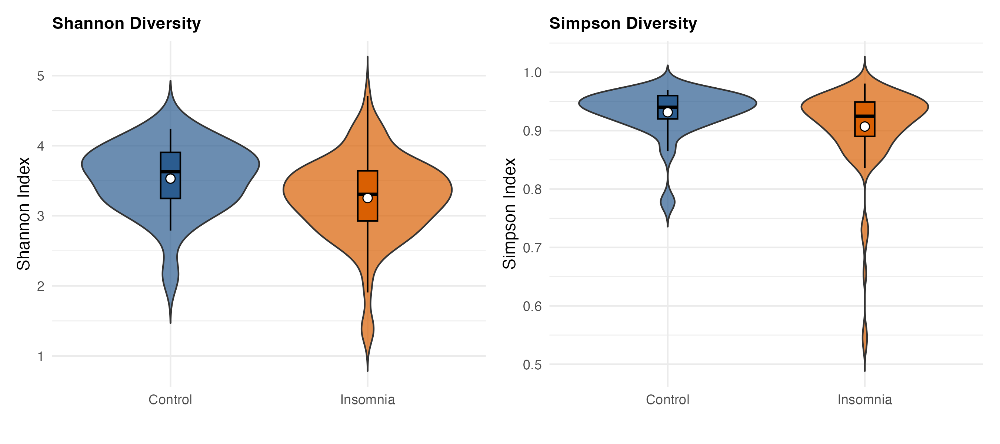
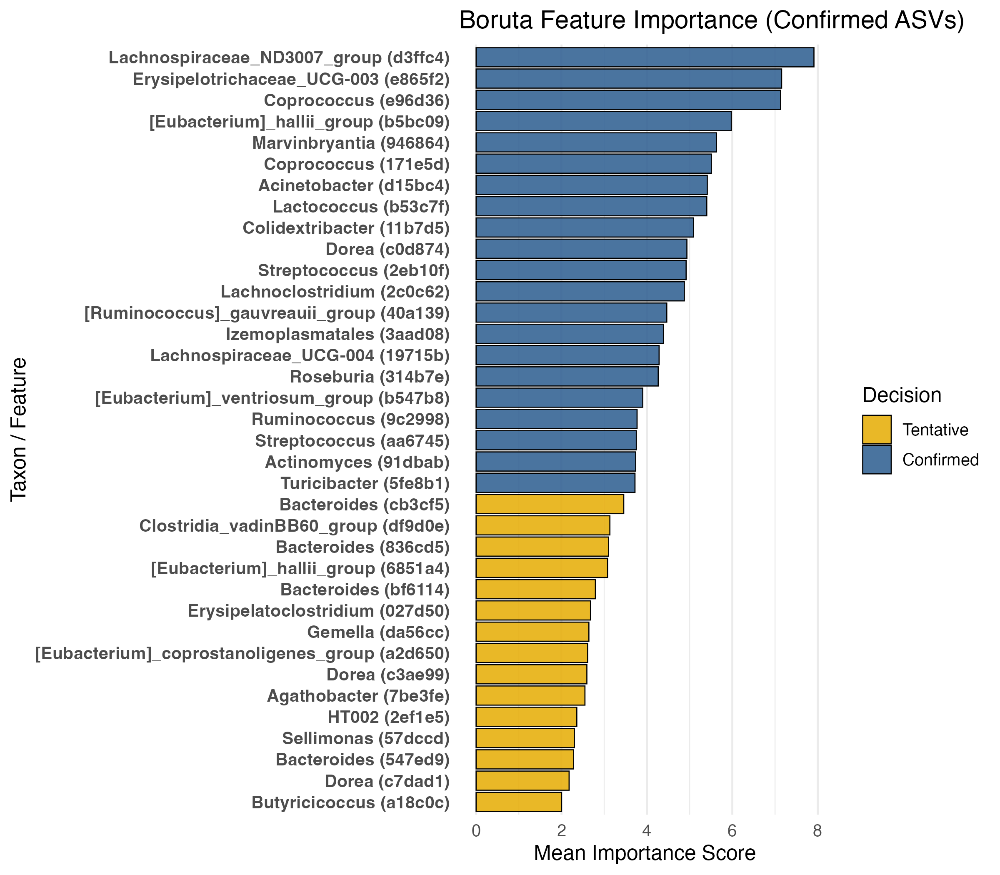
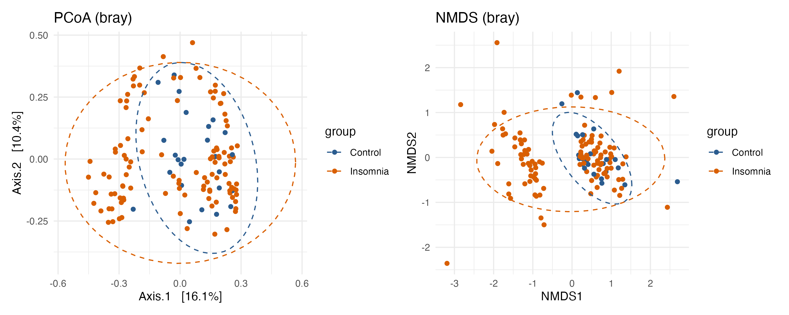
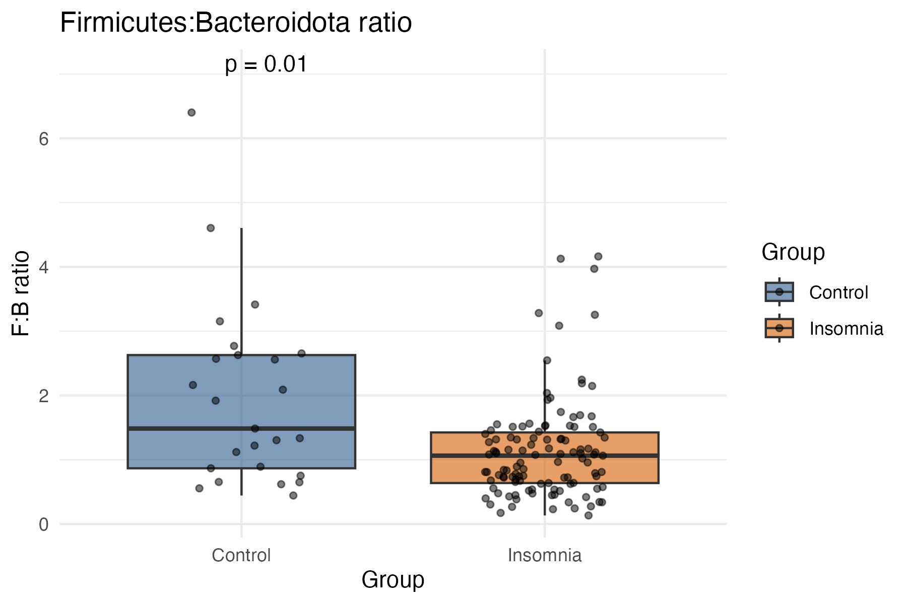
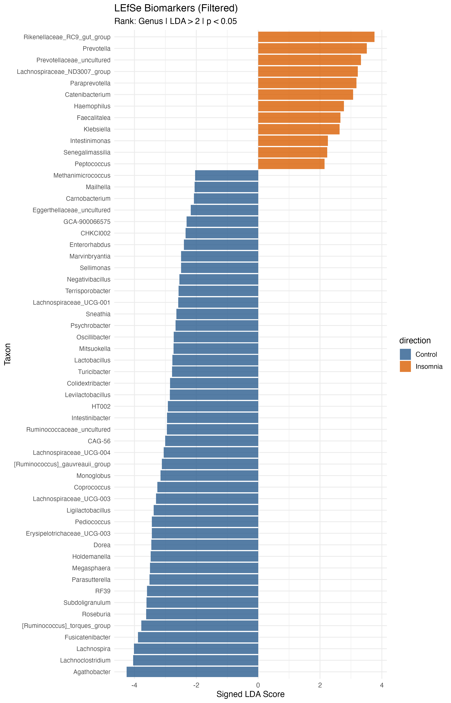
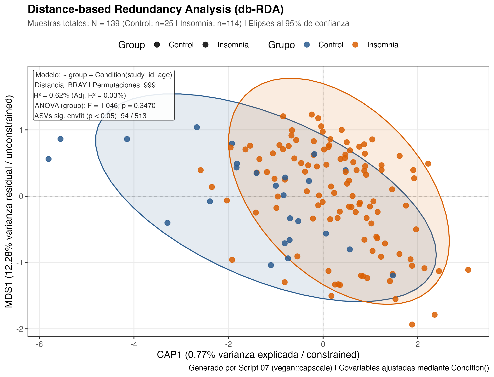
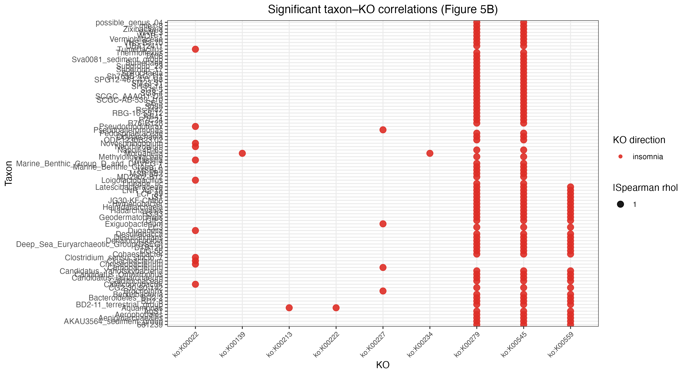
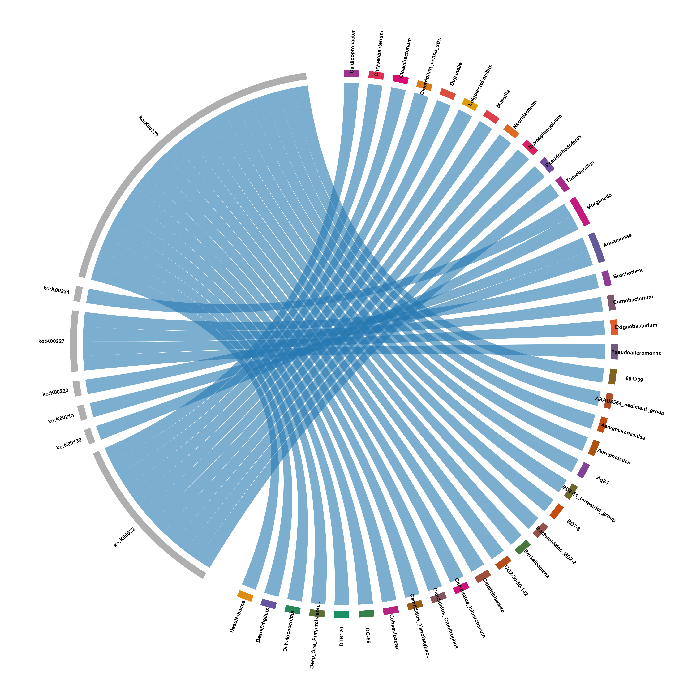

#READ.ME 18NOV26

# 🧬 16s_insomnia: Microbiota Analysis in Insomnia

Welcome to the official bioinformatics and meta-analysis pipeline repository for studying the role of the gut microbiome in insomnia. This project replicates and expands upon the methodological design of Park et al. (2026), integrating an end-to-end workflow from raw 16S rRNA amplicon sequencing preprocessing to diversity metrics, machine learning feature selection (Boruta), covariate-adjusted multivariate modeling (MaAsLin2, db-RDA, LEfSe), and PICRUSt2 functional profiling.

> **Executive Summary & Findings:** See [`report/`](report/) for the analysis summary, key statistical/ML findings, and engineering notes.

---

## 📊 Visual Showcase

| Community Diversity & Ordination | Biomarker, ML & Functional Profiling |
| :---: | :---: |
|  |  |
|  |  |
|  |  |
|  |  |
|  | *Full pipeline summary in [`report/`](report/)* |

---

## 🏗️ Project Structure

```text
16s_insomnia/
├── 16s_insomnia.Rproj
├── README.md
├── figures/                                      <-- Curated portfolio/publication figures
├── report/                                       <-- Executive summary & analysis reports
├── config/
│   └── config.yaml                               <-- Central pipeline configuration
│
├── 00_setup/
│   ├── setup_and_run.sh                          <-- Cross-platform bootstrap & runner script
│   ├── macbook_export_environment_audit.R
│   └── macbook_environment_audit_report.txt
│
├── 0_preprocessing/
│   ├── preprocessing_README.md
│   ├── preprocessing_README.html
│   ├── config/
│   │   └── datasets_config.tsv                   <-- Dynamic parameters (primers, truncation, layout)
│   ├── notes/
│   ├── script_drafts_ideas/                      <-- Drafts and experimental tests
│   └── scripts/
│       ├── 00_install_sra_tools.sh               <-- SRA tools installation
│       ├── 01_download_silva_classifier.sh       <-- SILVA classifier download (Full-Length)
│       ├── 01_download_study_sras_w_metadata.sh  <-- Raw FASTQ and SRA metadata download
│       ├── 01_install_qiime2.sh                  <-- QIIME 2 environment setup
│       ├── 02_metadata_qiime2_format.sh          <-- Base metadata formatting for QIIME 2
│       ├── 03_merge_study_w_downloaded_metadata.py <-- Enrich and harmonize clinical metadata (ISI, BMI, etc.)
│       ├── 04_qiime_import_and_trim.sh           <-- FASTQ import and primer removal (Cutadapt)
│       ├── 04_viz_quality_plot.sh                <-- .qzv generation for quality inspection
│       ├── 05_dada2_denoise_datasets.sh          <-- Denoising and error correction with DADA2
│       ├── 05b_visualize_denoise_stats.sh        <-- Statistical summary of DADA2 process
│       ├── 06_merge_cluster_export.sh            <-- Merge, VSEARCH 99% clustering, SILVA taxonomy, and R export
│       ├── 06b_visualize_unified_table.sh        <-- Generates summary visualization of unified table (.qzv)
│       └── 06D_build_master_metadata.py          <-- Builds final master metadata table (master_metadata_unified.tsv)
│
├── utils/                                        <-- Reusable R helper functions
│   ├── utils_io.R
│   ├── utils_phyloseq.R
│   ├── utils_plot.R
│   ├── utils_stats.R
│   └── utils_helper_functions.R
│
├── 1_meta_analysis/                              <-- Analytical pipeline scripts (01 to 15 + QC + run_all.R)
│
├── data/
│   ├── raw/                                      <-- Raw FASTQs per study and supplementary tables
│   └── pre_processed/
│       ├── metadata/                             <-- Formatted (*_q2.tsv) and enriched metadata
│       ├── unified/                              <-- Inputs for meta-analysis: unified_otu_table.tsv,
│       │                                             taxonomy.tsv, master_metadata_unified.tsv,
│       │                                             unified_rep_seqs.fasta
│       └── qiime2_workspace/
│
├── resources/                                    <-- SILVA classifiers and external resources
│   └── classifiers/
│
├── picrust2_out/                                 <-- Temporary/internal PICRUSt2 output directory
│
└── outputs/                                      <-- Pipeline output tables, logs, figures, and models
    ├── tables/
    ├── models/
    ├── logs/
    ├── figures/
    ├── dbrda/
    ├── lefse/
    ├── boruta/
    ├── function/
    └── function_contrib/
---

## ⚙️ Environment & Prerequisites

The pipeline runs inside a centralized Conda bioinformatics environment (qiime2-amplicon-2024.5).

### Quick Setup with the Master Runner (00_setup/setup_and_run.sh)

To set up and run the project across Linux Mint and macOS, use the setup script in 00_setup/:

1. Open a terminal in the project root (16s_insomnia/).

2. Make the script executable (first time only):

```
Bash
chmod +x 00_setup/setup_and_run.sh
```


3. Ejecuta el script maestro:

```bash
./setup_and_run.sh
```

his script detects your OS, checks/activates the qiime2-amplicon-2024.5 Conda environment, creates required output directories, and synchronizes R packages (NO RENV TO KEEP IT AGNOSTIC)
---

## 📥 0. Preprocessing Module (FASTQ → Unified Tables)

> **Workflow Note: This pipeline is designed to integrate an initial set of 3 primary studies (with modular support for adding up to 5 additional studies). Because public study metadata varies across cohorts, preprocessing is run cohort-by-cohort with manual metadata review rather than a single global run_all preprocessing script.

### 📋Preprocessing Workflow Summary

1. **Acquisition:** Download raw FASTQ files and run metadata from SRA using SRA Toolkit / pysradb.

2. **Harmonization:** Standardize clinical variables (ISI scores, BMI, geographic region, and group labels Control vs. Insomnia).

3. **QIIME 2 / DADA2 Processing:**
   - Remove region-specific primers using Cutadapt.
   - Perform error correction and denoising with DADA2 (supporting Paired-End or Single-End truncation settings).
   - Filter out low-depth samples (< 10,000 retained reads).
   - Assign taxonomy using a Naive Bayes classifier trained on SILVA 138.1 (99% reference).

4. **Global Integration:** Merge feature tables and cluster at 99% identity via VSEARCH to build a unified ASV/OTU vocabulary across cohorts and export clean tables for R.

For script-level details and configuration parameters (datasets_config.tsv), see 0_preprocessing/preprocessing_README.md.

---

## 📊 1. Meta-Analysis & Functional Module in R (1_meta_analysis/)

Once the unified feature table (unified_otu_table.tsv) and master metadata (master_metadata_unified.tsv) are ready, run the sequential meta-analysis pipeline:

```bash
conda activate qiime2-amplicon-2024.5
Rscript 1_meta_analysis/run_all.R
```

El pipeline de metaanálisis ejecuta de forma automatizada los siguientes componentes (respaldados por el diseño optimizado de Park et al.):

- **01. Phyloseq Object Construction (01_build_phyloseq.R)**: Loads unified OTU/ASV, taxonomy, and metadata tables; removes unwanted taxa (g_other/Unassigned) and zero-sum features/samples; and enforces standardized group factor levels.
- **02. Alpha Diversity (02_alpha_diversity.R)**: Computes richness and diversity indices (Shannon, Simpson), generates combined violin/boxplot figures via patchwork, and runs statistical group comparisons.
- **03. Beta Diversity & PERMANOVA (03_beta_diversity_permanova.R)**: Computes Bray-Curtis dissimilarities, generates combined PCoA and NMDS ordinations, and runs multivariate PERMANOVA models (vegan::adonis2) adjusting for clinical covariates (study_id, age, sex).
- **04. Firmicutes / Bacteroidota Ratio (04_fb_ratio.R)**: Quantifies the Firmicutes-to-Bacteroidota ratio across groups with statistical summaries and plots.
- **05 & 06. Machine Learning Feature Selection — Boruta (05_boruta.R & 06_boruta_pca_heatmap.R)**: Identifies discriminative ASVs using Boruta feature selection with covariates and generates PCA plots and Z-score heatmaps.
- **07. Constrained Ordination — db-RDA & Envfit (07_dbrda_envfit_fix.R)**: Performs stepwise model selection (ordiR2step), fits conditioned db-RDA models (capscale), aligns envfit vectors with p.max = 1 to prevent p-value recycling/misalignment, and exports ordination and biplot figures.
- **08. Differential Biomarkers — LEfSe (08_lefse.R)**: Runs LEfSe via microbiomeMarker (run_lefse), annotates full taxonomic paths, and plots signed LDA score bar charts.
- **09. Differential Abundance — MaAsLin2 (09_maaslin2_taxa.R)**: Fits multivariable linear models across fixed effects while disabling MaAsLin2's legacy internal plots (plot_heatmap = FALSE, plot_scatter = FALSE) to avoid modern ggplot2 version crashes.
- **10–15. Functional Profiling (10A_run_picrust2.sh through 15_function_chord_from_ko_fc.R)**:
  - Predicts unstratified KEGG Ortholog (KO) profiles via PICRUSt2 (with SEPP placement for macOS/Linux stability).
  - Computes vectorized Spearman correlations between target taxa and KO functions (cutting runtime from hours to seconds).
  - Quantifies per-sample and differential functional contributions, exports KO lists for ClueGo, and generates memory-safe chord diagrams (capped to top associations/KOs to prevent OOM crashes) and dotplots.

---

## 📌 Key Engineering & Methodological Notes
1. **Cross-Cohort Consistency:** Clustering unified features at 99% via VSEARCH avoids biases from calling ASVs independently per cohort.

2. **Stability & Memory Safety:** Clustering unified features at 99% via VSEARCH avoids biases from calling ASVs independently per cohort.

3. **Reproducibility:** Centralized config/config.yaml parameters, renv.lock package management, and 00_setup/setup_and_run.sh support consistent execution across Linux Mint and macOS.

---

## Installation & Environment Setup

This project integrates QIIME 2 and the R package `phyloseq`. To prevent environmental dependency conflicts inside the Conda environment, R dependencies must be built natively using system headers.

### 1. Prerequisites (Linux System Libraries)
Before setting up the environment, you must install the required development headers for compiling data transfer and XML manipulation packages in Linux:
```bash
sudo apt update
sudo apt install libcurl4-openssl-dev libssl-dev libxml2-dev
```

### 2. Activate Environment
Activate your managed QIIME 2 deployment containing your pre-compiled dependencies:
```bash
conda activate qiime2-amplicon-2024.5
```

### 3. Install Phyloseq (Inside the Environment)
To keep the environment stable, launch the internal R environment directly from your terminal session and deploy `phyloseq` using `BiocManager`:

1. Open the environment-bound R console:
   ```bash
   R
   ```
2. Run the deployment execution block within the active session:
   ```R
   if (!require("BiocManager", quietly = TRUE)) install.packages("BiocManager")
   BiocManager::install("phyloseq")
   q(save="no")
   ```

### 4. Verification
Verify that the package initializes successfully without throwing compilation errors:
```bash
Rscript -e "library(phyloseq); cat('✅ Phyloseq initialization verified!\n')"
```
---

---
# Pipeline: Inputs → Outputs per Script

## 1_meta_analysis/
# Pipeline: Inputs → Outputs per Script (`1_meta_analysis/`)

---

### `00_setup.R`

* **Inputs:**
* `config/config.yaml` (from user configuration setup)


* **Outputs:** Loaded global environment configuration (`cfg`), random seed assignment, and shared R library environments.

---

### `01_build_phyloseq.R`

* **Inputs:**
* `data/pre_processed/unified/unified_otu_table.tsv` (from `06_merge_cluster_export.sh`)
* `data/pre_processed/unified/taxonomy.tsv` (from `06_merge_cluster_export.sh`)
* `data/pre_processed/unified/master_metadata_unified.tsv` (from `06D_build_master_metadata.py`)
* `config/config.yaml` (from user configuration setup)


* **Outputs:**
* `outputs/models/physeq_filtered.rds` ⚠️ **Primary filtered phyloseq object**
* `outputs/tables/otu_filtered.csv`
* `outputs/tables/tax_filtered.csv`
* `outputs/tables/metadata_filtered.csv`


---

### `02_alpha_diversity.R` (+ QC script)

* **Inputs:**
* `outputs/models/physeq_filtered.rds` (from `01_build_phyloseq.R`)
* `config/config.yaml` (from user configuration setup)


* **Outputs:**
* `outputs/tables/alpha_diversity.csv`
* `outputs/figures/alpha_shannon_simpson.png`
* `outputs/logs/alpha_diversity_stats.txt`


---

### `03_beta_diversity_permanova.R` (+ QC script)

* **Inputs:**
* `outputs/models/physeq_filtered.rds` (from `01_build_phyloseq.R`)
* `config/config.yaml` (from user configuration setup)


* **Outputs:**
* `outputs/tables/beta_diversity.csv`
* `outputs/figures/beta_pcoa_nmds.png`
* `outputs/logs/permanova.txt`


---

### `04_fb_ratio.R` (+ QC script)

* **Inputs:**
* `outputs/models/physeq_filtered.rds` (from `01_build_phyloseq.R`)
* `config/config.yaml` (from user configuration setup)


* **Outputs:**
* `outputs/tables/fb_ratio.csv`
* `outputs/figures/fb_ratio.png`
* `outputs/logs/fb_ratio_stats.txt`


---

### `05_boruta.R` (+ QC script)

* **Inputs:**
* `outputs/models/physeq_filtered.rds` (from `01_build_phyloseq.R`)
* `config/config.yaml` (from user configuration setup)


* **Outputs:**
* `outputs/boruta/boruta_model.rds`
* `outputs/boruta/boruta_selected_otu.csv`
* `outputs/boruta/boruta_selected_otus_with_taxonomy.csv`
* `outputs/boruta/boruta_importance_clean.png`


---

### `06_boruta_pca_heatmap.R` (+ QC script)

* **Inputs:**
* `outputs/boruta/boruta_selected_otu.csv` (from `05_boruta.R`)
* `outputs/models/physeq_filtered.rds` (from `01_build_phyloseq.R`)
* `config/config.yaml` (from user configuration setup)


* **Outputs:**
* `outputs/boruta/boruta_pca.png`
* `outputs/boruta/boruta_heatmap_samples.png`


---

### `07_dbrda_envfit_fix.R` (+ QC script)

* **Inputs:**
* `outputs/models/physeq_filtered.rds` (from `01_build_phyloseq.R`)
* `config/config.yaml` (from user configuration setup)


* **Outputs:**
* `outputs/dbrda/ordiR2step_model.rds`
* `outputs/dbrda/dbrda_model.rds`
* `outputs/dbrda/dbrda_anova_all.csv`
* `outputs/dbrda/dbrda_anova_margin.csv`
* `outputs/dbrda/dbrda_r2.txt`
* `outputs/dbrda/envfit_significant_otus_with_taxonomy.csv`
* `outputs/dbrda/dbrda_sites.pdf`


---

### `08_lefse.R` (+ QC script)

* **Inputs:**
* `outputs/models/physeq_filtered.rds` (from `01_build_phyloseq.R`)
* `config/config.yaml` (from user configuration setup)


* **Outputs:**
* `outputs/lefse/lefse_result.csv`
* `outputs/lefse/lefse_sig_with_otu.csv`
* `outputs/lefse/lefse_barplot.png`


---

### `09_maaslin2_taxa.R`

* **Inputs:**
* `outputs/models/physeq_filtered.rds` (from `01_build_phyloseq.R`)
* `config/config.yaml` (from user configuration setup)


* **Outputs:**
* `outputs/maaslin2/` (MaAsLin2 output directory)
* `outputs/maaslin2/maaslin2_sig_with_taxonomy.csv`


---

### `10A_run_picrust2.sh`

* **Inputs:**
* `data/pre_processed/unified/unified_rep_seqs.fasta` (from `06_merge_cluster_export.sh`)
* `data/pre_processed/unified/unified_otu_table.tsv` (or `.biom`) (from `06_merge_cluster_export.sh`)
* `config/config.yaml` (from user configuration setup)


* **Outputs:**
* `outputs/tables/merged_KO_metagenome.tsv` ⚠️ **Predicted unstratified functional profiles**


---

### `10B_function_taxa_ko_cor.R` (+ QC script)

* **Inputs:**
* `outputs/tables/merged_KO_metagenome.tsv` (from `10A_run_picrust2.sh`)
* `outputs/models/physeq_filtered.rds` (from `01_build_phyloseq.R`)
* `config/config.yaml` (from user configuration setup)


* **Outputs:**
* `outputs/function/tables/taxon_ko_cor_all.csv`
* `outputs/function/tables/taxon_ko_edges_filtered.csv` ⚠️ **Significant Spearman taxon-KO correlations**


---

### `11_function_chord_edges.R`

* **Inputs:**
* `outputs/function/tables/taxon_ko_edges_filtered.csv` (from `10B_function_taxa_ko_cor.R`)
* `outputs/models/physeq_filtered.rds` (from `01_build_phyloseq.R`)
* `config/config.yaml` (from user configuration setup)


* **Outputs:**
* `outputs/function/figures/chord_taxon_ko.png`
* `outputs/function/figures/chord_taxon_ko.pdf`


---

### `12_function_dotplot.R`

* **Inputs:**
* `outputs/function/tables/taxon_ko_edges_filtered.csv` (from `10B_function_taxa_ko_cor.R`)
* `config/config.yaml` (from user configuration setup)


* **Outputs:**
* `outputs/function/figures/figure5b_taxon_ko_dotplot.png`


---

### `13a_extract_ko_contrib.R` (+ QC script)

* **Inputs:**
* `outputs/models/physeq_filtered.rds` (from `01_build_phyloseq.R`)
* `outputs/function/tables/taxon_ko_edges_filtered.csv` (from `10B_function_taxa_ko_cor.R`)
* `outputs/tables/merged_KO_metagenome.tsv` (from `10A_run_picrust2.sh`)


* **Outputs:**
* `outputs/tables/metadata_for_taxa.csv`
* `outputs/tables/picrust_taxonomy_filled.csv`
* `outputs/tables/KO_FC_group.csv`
* `outputs/tables/ko_contrib_filtered.csv` ⚠️ **Filtered per-sample functional contributions**


---

### `13b_function_contribution_diff.R` (+ QC script)

* **Inputs:**
* `outputs/tables/ko_contrib_filtered.csv` (from `13a_extract_ko_contrib.R`)
* `outputs/tables/metadata_for_taxa.csv` (from `13a_extract_ko_contrib.R`)
* `outputs/tables/KO_FC_group.csv` (from `13a_extract_ko_contrib.R`)


* **Outputs:**
* `outputs/function_contrib/differential_functional_contributions.csv`


---

### `14_export_ko_list_for_cluego.R`

* **Inputs:**
* `outputs/function/tables/taxon_ko_edges_filtered.csv` (from `10B_function_taxa_ko_cor.R`)
* `config/config.yaml` (from user configuration setup)


* **Outputs:**
* `outputs/function_contrib/network/cluego_gene_list_KO.txt`


---

### `15_function_chord_from_ko_fc.R`

* **Inputs:**
* `outputs/tables/KO_FC_group.csv` (from `13a_extract_ko_contrib.R`)
* `config/config.yaml` (from user configuration setup)


* **Outputs:**
* `outputs/function/figures/chord_ko_fc.png`


---

### `run_all.R`

* **Inputs:** Sequential execution queue of all active preprocessing and metaanalysis scripts (`01` through `15`).
* **Outputs:** Full runtime logs and complete unified `outputs/` directory structure.
---

---
## 0_preprocessing/

---

### `00_install_sra_tools.sh`
- **Inputs:** None (checks system for `prefetch` / `fasterq-dump`)
- **Outputs:** SRA Toolkit installed at `/usr/local/sra-toolkit/bin` (system-level; no repo files)

---

### `01_install_qiime2.sh`
- **Inputs:** None (downloads `qiime2-amplicon-2024.5_py39-osx-conda.yml` from data.qiime2.org)
- **Outputs:** Conda environment `qiime2-amplicon-2024.5`

---

### `01_download_silva_classifier.sh`
- **Inputs:** Official URL `silva-138-99-nb-classifier.qza` (~500 MB)
- **Outputs:**
  - `resources/classifiers/silva-138-99-nb-classifier.qza` ⚠️ **critical resource**

---

### `01b_download_study_sras.sh`
- **Inputs:** `0_preprocessing/config/sra_projects.tsv` (DATASET, PROJECT columns)
- **Outputs:**
  - `data/raw/{run_id}/*.fastq.gz` (compressed FASTQs)
  - SRA metadata downloaded via `pysradb`

---

### `02_metadata_qiime2_format.sh`
- **Inputs:**
  - `0_preprocessing/config/datasets_config.tsv`
  - `data/raw/{STUDY}/{STUDY}_metadata_detailed.csv` (from step 01b)
  - `0_preprocessing/utils/02_metadata_qiime2_format_engine.py`
- **Outputs:**
  - `data/preprocessed/metadata/{STUDY}_metadata_q2.tsv` ⚠️ **QIIME 2-formatted metadata (with `#q2:types` header)**

---

### `03_merge_study_w_downloaded_metadata.py`
- **Inputs:**
  - `data/preprocessed/metadata/{STUDY}_metadata_q2.tsv`
  - `data/raw/{STUDY}/table_s1.csv` (supplementary clinical data, study-dependent)
  - `0_preprocessing/utils/metadata_q2_enriched_engine.py`
- **Outputs:**
  - `data/preprocessed/metadata/{STUDY}_metadata_q2_format_enriched.tsv` ⚠️ **enriched metadata ready for merging**

---

### `04_qiime_import_and_trim.sh`
- **Inputs:**
  - `0_preprocessing/config/datasets_config.tsv` (primers, truncation params)
  - `data/raw/{STUDY}/*.fastq.gz`
- **Outputs:**
  - `data/pre_processed/qiime2_workspace/manifests/{STUDY}_manifest.tsv`
  - `data/pre_processed/qiime2_workspace/{STUDY}/demux.qza`
  - `data/pre_processed/qiime2_workspace/{STUDY}/demux_trimmed.qza` ⚠️ **primer-trimmed reads**

---

### `04_viz_quality_plot.sh`
- **Inputs:**
  - `data/pre_processed/qiime2_workspace/{STUDY}/demux_trimmed.qza`
- **Outputs:**
  - `data/pre_processed/qiime2_workspace/{STUDY}/demux_trimmed.qzv` (quality visualization)

---

### `05_dada2_denoise_datasets.sh`
- **Inputs:**
  - `0_preprocessing/config/datasets_config.tsv` (truncation lengths, paired/single flag)
  - `data/pre_processed/qiime2_workspace/{STUDY}/demux_trimmed.qza`
- **Outputs (per study):**
  - `{STUDY}/table.qza` ⚠️ **feature table**
  - `{STUDY}/rep_seqs.qza` ⚠️ **representative sequences**
  - `{STUDY}/denoising_stats.qza`

---

### `05b_visualize_denoise_stats.sh`
- **Inputs:**
  - `0_preprocessing/config/datasets_config.tsv`
  - `data/pre_processed/metadata/{STUDY}_metadata_q2.tsv`
  - `{STUDY}/denoising_stats.qza`, `{STUDY}/table.qza`, `{STUDY}/rep_seqs.qza`
- **Outputs:**
  - `{STUDY}/denoising_stats.qzv`
  - `{STUDY}/table.qzv`
  - `{STUDY}/rep_seqs.qzv`

---

### `06_merge_cluster_export.sh`
- **Inputs:**
  - `0_preprocessing/config/datasets_config.tsv`
  - `resources/classifiers/silva-138-99-nb-classifier.qza`
  - `qiime2_workspace/{STUDY}/table.qza` + `rep_seqs.qza` (all active studies)
- **Outputs:**
  - **Internal (QIIME 2 workspace):**
    - `qiime2_workspace/unified/merged_table_raw.qza`
    - `qiime2_workspace/unified/merged_rep_seqs.qza`
    - `qiime2_workspace/unified/final_unified_table.qza` ⚠️ **VSEARCH 99% clustered**
    - `qiime2_workspace/unified/unified_rep_seqs.qza`
    - `qiime2_workspace/unified/taxonomy.qza`
  - **Human-readable export:**
    - `data/pre_processed/unified/unified_otu_table.tsv` ⚠️
    - `data/pre_processed/unified/unified_otu_table.csv` ⚠️
    - `data/pre_processed/unified/unified_rep_seqs.fasta` ⚠️
    - `data/pre_processed/unified/taxonomy.tsv` ⚠️

---

### `06b_visualize_unified_table.sh`
- **Inputs:**
  - `qiime2_workspace/unified/final_unified_table.qza`
  - `qiime2_workspace/unified/unified_rep_seqs.qza`
  - `qiime2_workspace/unified/taxonomy.qza`
- **Outputs:**
  - `qiime2_workspace/unified/final_unified_table.qzv`
  - `qiime2_workspace/unified/unified_rep_seqs.qzv`
  - `qiime2_workspace/unified/taxonomy.qzv`

---

### `06D_build_master_metadata.py`
- **Inputs:**
  - `data/preprocessed/metadata/*_metadata_q2_format_enriched.tsv` (glob)
- **Outputs:**
  - `data/preprocessed/unified/master_metadata_unified.tsv` ⚠️ **master metadata for R/phyloseq**

---

## Key "hand-off" artifacts to `1_meta_analysis/`

| Artifact | Produced by | Consumed by |
|---|---|---|
| `unified_otu_table.tsv` | `06_merge_cluster_export.sh` | `utils_io.R` → `01_build_phyloseq.R` |
| `taxonomy.tsv` | `06_merge_cluster_export.sh` | `utils_io.R` → `01_build_phyloseq.R` |
| `unified_rep_seqs.fasta` | `06_merge_cluster_export.sh` | `10A_run_picrust2.sh` |
| `master_metadata_unified.tsv` | `06D_build_master_metadata.py` | `utils_io.R` → `01_build_phyloseq.R` |
| `merged_KO_metagenome.tsv` | `10A_run_picrust2.sh` | `13a_extract_ko_contrib.R` |


